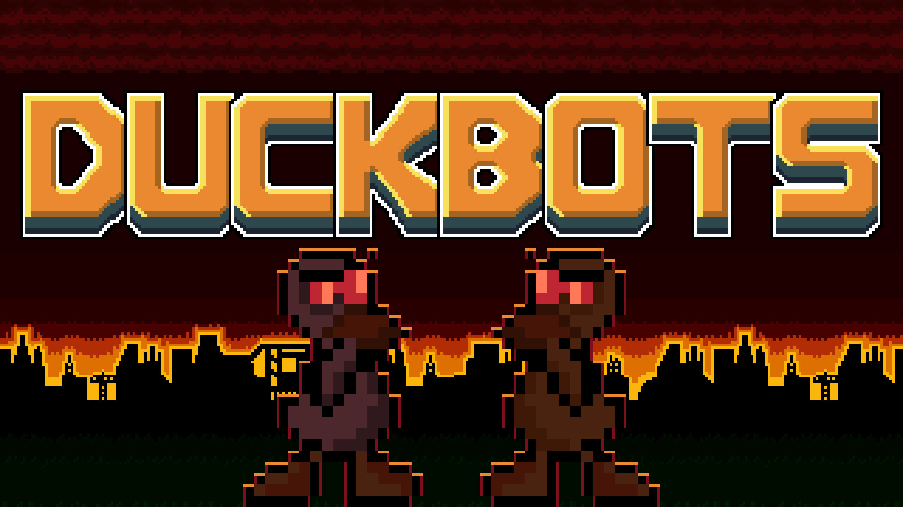
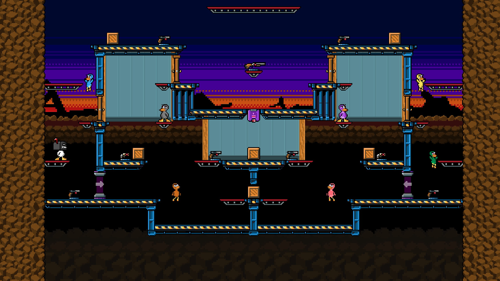
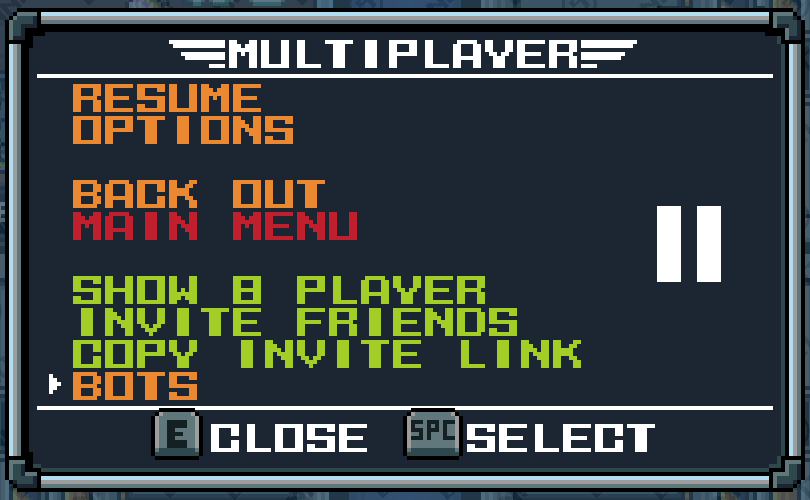

# DuckBots

[English](README.md) · **Русский**

Компьютерные утки для [Duck Game](https://store.steampowered.com/app/312530/Duck_Game/). Заполните пустое лобби ботами и сыграйте настоящий матч — офлайн или по сети с друзьями, у которых мода нет.


[](LICENSE)
[](https://steamcommunity.com/sharedfiles/filedetails/?id=3823678387)
[](https://store.steampowered.com/app/312530/Duck_Game/)
[](https://github.com/dhsuioa/DuckBots/issues)



## Что умеют боты

- **Находят оружие.** Бот идёт к ближайшему стволу, до которого реально можно добраться: расстояние меряется по пути, а не по прямой. Ящики с оружием и подарки боты тоже открывают.
- **Ходят по карте.** Бегают, прыгают, проваливаются сквозь платформы, летают на пружинах и телепортах, проходят через двери. Стекло на пути разбивают подкатом или выстрелом. Шипы, пилы, установленные мины и пропасти обходят.
- **Дерутся.** Бот ищет позицию для выстрела на высоте врага и разворачивается к нему. Если враг подошёл слишком близко, отходит, не поворачиваясь к нему спиной. Стреляет вверх на взмахах крыльями и сквозь стекло, бьёт из гранатомёта навесом по врагу выше или ниже себя, жжёт огнемётом вблизи, холодным оружием бьёт вплотную, а из базуки в упор не стреляет.
- **Уклоняются.** Когда в бота целятся, он уходит подкатом под пулю. Если его сбили с ног, сразу встаёт.
- **Пользуются сеткомётом.** Ловят утку сеткой, несут к краю и сбрасывают в пропасть.
- **Играют по сети.** Когда хостите вы, боты заходят как ваши дополнительные локальные игроки, и все видят их обычными утками. Друзьям мод не нужен.



## Как это устроено

DuckBots не двигает уток сам и не меняет правила игры. Каждый бот — это виртуальный геймпад: мод решает, какие кнопки нажать, а физику, оружие и смерть Duck Game обрабатывает так же, как для живого игрока.

1. **Карта.** В начале раунда мод раскладывает уровень на сетку клеток: пол, платформы, стены, пружины, двери, телепорты и опасности.
2. **Прыжки.** Каждый возможный прыжок просчитывается кадр за кадром физикой самой утки. Эту физику сверили примерно с 12 000 кадров, записанных в настоящих матчах. Каждый прыжок хранится как последовательность нажатий.
3. **Маршрут.** По этой карте бот ищет путь к оружию, к позиции для выстрела или к врагу.
4. **Мозг.** Каждый кадр бот решает, что делать: бежать от гранаты, драться, подобрать оружие или догонять. И нажимает кнопки.

## Установка

- **Из Steam Workshop:** подпишитесь на [странице мода](https://steamcommunity.com/sharedfiles/filedetails/?id=3823678387) и перезапустите игру.
- **Вручную:** скачайте `DuckBots-<версия>.zip` со страницы [Releases](https://github.com/dhsuioa/DuckBots/releases), распакуйте в `%APPDATA%\DuckGame\Mods\` так, чтобы получилось `Mods\DuckBots\DuckBots.dll`, и перезапустите игру.

## Как играть

**Офлайн.** В лобби откройте меню паузы и выберите **BOTS**. Каждая из семи строк — это один бот: переключите его с `OFF` на уровень. Боты занимают свободные комнаты с последней и никогда не садятся в первую — она ваша. Выбор запоминается между запусками.




**Свой сервер.** В меню паузы лобби выберите **INVITE FRIENDS**. В сетевом лобби в меню паузы рядом с EDIT SLOTS появится **BOTS** — ботов можно добавлять и убирать на ходу. Во время матча у хоста есть ещё **SKIP**, чтобы закончить раунд, если боты застряли.

**В гостях у друга.** Сядьте в своё лобби с ботами и примите приглашение друга или зайдите к нему из списка друзей Steam. Боты придут с вами как ваши локальные игроки. У хоста должно хватить свободных мест на вас и ботов.

**Лобби незнакомцев.** Если заходите через быстрый поиск или браузер серверов, боты остаются дома: мод не приводит их к тем, кто вас не звал.

Уровни в меню (`DUCKLING`, `AVERAGE`, `GOOD`, `BEAST`) пока ничего не меняют. Все боты играют в полную силу, настоящие уровни сложности появятся в следующих версиях.

### Как работает сеть без мода у других

Duck Game пускает игрока в лобби, только если у него включены те же моды, и сверяет для этого отпечаток списка модов. DuckBots не добавляет ни новых предметов, ни сетевых сообщений, так что для остальных это та же самая игра, и мод исключает себя из отпечатка. Друзья видят ботов как `ВашеИмя(2)`, `ВашеИмя(3)` и так далее — предупредите их, что это боты.

### Консольные команды

Консоль открывается клавишей `~`:

- `nextround` заканчивает текущий раунд, если боты застряли.
- `botdebug` показывает над каждым ботом его режим и включает подробный журнал.
- `botlog` пишет в подробный журнал каждый кадр каждой утки.

## Известные проблемы

- **PLAY ONLINE неактивна («FULL GAME»)**, если в лобби три бота и больше: игра считает ботов игроками. Используйте **INVITE FRIENDS** в меню паузы.
- **В сетевом лобби кончились места.** Мест в лобби ограниченное число, и боты их занимают. Хост может открыть больше через **EDIT SLOTS**.
- **В гостях ботов не поменять:** после входа остаются те, с которыми пришли.
- **Боты всё ещё иногда застревают.** Используйте **SKIP** по сети или `nextround` офлайн.
- **Шипы.** На некоторых картах боты всё ещё прыгают по маршруту прямо на шипы.
- **Чем боты пока не умеют пользоваться:**
  - лучом захвата, радиоуправляемой машинкой и магнитной пушкой — такое оружие они не подбирают;
  - заряжаемым оружием вроде Death Ray и Coil Gun;
  - дугой гранатной пушки.
- **Без экипировки.** Броню и реактивный ранец боты не надевают.

## Планы

Порядок может меняться по отзывам игроков. Сроков нет: каждое изменение проверяется в настоящих матчах, прежде чем браться за следующее.

**Сделано в 0.3**

- [x] Сбитый с ног бот сразу встаёт, а не лежит по нескольку секунд.
- [x] Ближний бой: боты отходят от врага лицом к нему, а не крутятся на месте.
- [x] Гранатомёт стреляет по прицельной дуге, и боты попадают во врага выше и ниже себя.
- [x] Огнемёт и ракетница работают: огнемётом боты жгут вблизи, не отпуская огонь, а ракетницей стреляют с той дистанции, откуда попадают.
- [x] Стекло: боты разбивают его подкатом на пути и стреляют сквозь него во врага за ним.

**Сделано в 0.2**

- [x] Боты больше не застревают, бесконечно прыгая на пружине под потолком: в полёте они рулят.
- [x] Ящик с оружием стал таким же поводом, как ствол на полу: боты больше не бегут к дальнему стволу мимо ящика рядом.
- [x] Своя дальность у каждого ствола: снайперы стреляют издалека, ближнее оружие ждёт, пока подойдёт.
- [x] Боты не подбирают оружие, которым пока не умеют пользоваться (луч захвата, машинка, магнит).

**В ближайших версиях**

- [ ] Боты перестают прыгать на шипы.
- [ ] Гранатная пушка и падение пули у оружия, на которое действует гравитация.
- [ ] Луч захвата: схватить врага и увести его с обрыва.
- [ ] Фиолетовые блоки: класть туда копию хорошего ствола и забирать свежие копии в следующих раундах.

**Позже**

- [ ] Настоящие уровни сложности от `DUCKLING` до `BEAST`: реакция, меткость, выбор оружия, чувство опасности.
- [ ] Тушить огонь огнетушителем или водой.
- [ ] Экипировка: реактивный ранец, шлемы и броня.
- [ ] Верёвки и лианы.
- [ ] Заряжаемое оружие (Death Ray, Coil Gun) и разумная перезарядка мушкета и его родственников.
- [ ] Доводка сети: PLAY ONLINE с тремя ботами и больше, подсказка в игре, когда в лобби нет мест.
- [ ] Лучше понимать карту: двери, которые закрывают линию огня, маленькие выступы, трубы, ключи и запертые двери.

## Как сообщить об ошибке

Мод ведёт короткий журнал: что делали боты и почему. Он лежит в `%APPDATA%\DuckGame\DuckBots-data\botlog.txt`. При запуске игры журнал начинается заново, а прошлый запуск сохраняется как `botlog.prev.txt`. Приложите его к [issue на GitHub](https://github.com/dhsuioa/DuckBots/issues), напишите карту и что вы видели.

## Сборка из исходников

Понадобятся:

- Duck Game из Steam;
- `csc.exe` из .NET Framework 4.x (`C:\Windows\Microsoft.NET\Framework64\v4.0.30319`). Код на C# 5, поэтому без интерполяции строк и без `?.`;
- `0Harmony.dll` из [Lib.Harmony](https://github.com/pardeike/Harmony) 2.2.2, сборка `net472`, в папке мода;
- `mod.conf` в папке мода:

```xml
<?xml version="1.0" encoding="utf-8"?>
<Mod>
  <MajorSupportedRevision>1</MajorSupportedRevision>
  <NoCompilation>true</NoCompilation>
</Mod>
```

Пути к игре и к папке мода задаются в начале `build.cmd`. Он собирает все `src/**/*.cs` в `DuckBots.dll` в папке мода. Игра подхватывает DLL только при запуске, поэтому после сборки её нужно перезапустить полностью. Исходники в папку мода не кладите: найдя там `.cs`, игра попробует собрать их сама и не подключит Harmony.

При запуске мод проверяет мозг бота без игры, и первая строка `botlog.txt` говорит, прошла ли проверка. Чтобы при разработке получать подробный журнал и подписи режимов, создайте пустой `debug.txt` в `%APPDATA%\DuckGame\DuckBots-data\`.

### Устройство `src/`

- `DuckBotsMod.cs` — вход мода и патчи Harmony.
- `Brain/` — решения бота. `Nav/` — карта проходимости, симуляция прыжков и поиск пути. Ни та, ни другая папка не знает игровых типов, поэтому самопроверка гоняет их без игры.
- `Game/` — всё, что касается игры: ввод бота, лобби, сеть, что бот видит (`Look`) и маршруты.
- `Journal/` пишет журналы.
- `Tests/` — самопроверка, по файлу на тему.

## Как помочь

Правки присылайте через pull request. Пара практических правил:

- **Одно изменение поведения на pull request.** Поведение ботов проверяется только игрой. Если в один матч попало несколько изменений, уже не понять, какое из них сделало ботов лучше или хуже.
- **Начинайте с журнала.** Найдите причину в `botlog.txt` до правки кода, а с `debug.txt` — ещё и в `botlog-detail.txt`. Где логика чистая, добавьте случай в самопроверку в `Tests/`.
- **Язык.** Большая часть комментариев, журналов и сообщений коммитов сейчас на русском, но английский тоже подходит: комментарии, коммиты и pull request можно писать на любом из двух языков.

## Лицензия

Copyright (C) 2026 dhsuioa

DuckBots — свободная программа: её можно распространять и изменять на условиях GNU General Public License версии 3 или, по вашему выбору, любой более поздней версии, опубликованной Free Software Foundation. Текст лицензии — в [LICENSE](LICENSE).

**Дополнительное разрешение по разделу 7 GNU GPL версии 3.** Если вы изменяете эту программу или любое произведение на её основе, связывая или объединяя её с Duck Game (или изменённой версией игры), части которой подпадают под условия лицензии Duck Game, или с Harmony (Lib.Harmony), правообладатели этой программы дают вам дополнительное разрешение распространять полученное произведение. Юридически значим английский текст этого разрешения в [README.md](README.md#license).

DuckBots использует [Harmony](https://github.com/pardeike/Harmony) Андреаса Пардейке, лицензия MIT. DuckBots — фанатский мод, не связанный с разработчиками и издателями Duck Game.
